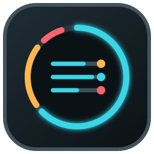

# T3 Code Status for OpenDeck


## At a glance

An OpenDeck key that shows how many T3 Code threads are currently working.




T3 Code Status adds OpenDeck keys that show what your open T3 Code threads are doing: how many are working, which need your approval, answer, or plan review, and which failed or hit a usage limit. Each key shows one large number or symbol, so it stays readable on a 2 cm key. Status arrives through a live stream. Press a key to retry an offline connection.

This is an unofficial community plugin. It is not part of T3 Code or OpenDeck.

## Install

The plugin needs Node.js 20 or newer installed on the host system. OpenDeck starts JavaScript plugins with this system-wide `node` executable. You do not need pnpm for a normal installation.

The plugin needs T3 Code 0.1 or newer, which uses orchestration protocol 2. It reports **Unsupported T3 version** for older or newer protocols instead of showing wrong counts.

1. Start T3 Code and leave its server running.
2. Install `com.beastyrabbit.t3-code-status.streamDeckPlugin` through OpenDeck's plugin manager.
3. Drag `Thread status` from the `T3 Code Status` category onto a free key.
4. In T3 Code, open **Settings → Connections**. Enable **Network access** if the pairing controls are hidden, then create a **Read only** pairing link.
5. Paste the complete link into the key's **Pair an environment** field and select **Pair**. Use the link within five minutes, without opening it elsewhere first.

### Pair all your machines

Each T3 Code server shows only its own threads and accepts only tokens it issued itself, so the plugin needs one read-only token per machine, up to 16. Tailscale makes the machines reachable, but it does not authorize the plugin. Your T3 Code app shows every machine because it keeps a separate connection to each one, and other programs cannot use those connections. Pairing links from **Settings → Connections** also belong to the machine whose app creates them. All keys share the paired connections.

**Over SSH (recommended).** If the machine that runs OpenDeck can already SSH into your machines without a password prompt, the settings panel pairs them all at once:

1. Under **Pair machines over SSH**, select **Find**. The plugin runs `tailscale status --json` and asks each online device for `/.well-known/t3/environment` on port 3773. It never connects over SSH for this. The machines that answer as T3 Code servers are added to the list. You can also type hosts yourself, such as `studio, buildbox, devbox:3774`.
2. Select **Pair all**. For each host, the plugin runs `t3 auth pairing create --scope orchestration:read --ttl 5m --json` over SSH, then pairs the returned token with the T3 server at `http://<host>:3773`. The token is never shown or logged.
3. Read the result below the button: one line with the paired machines, and one line for each machine that failed.

T3 authorizations expire after about 30 days. The list keeps every machine that is already paired, so selecting **Pair all** again renews them all.

**By hand.** On a machine SSH cannot reach, open that machine's own T3 Code app, create a **Read only** link in **Settings → Connections**, and paste it into **Pair an environment** on the OpenDeck machine. Repeat this after the authorization expires.

**How Pair all reaches each machine**

- **SSH user and keys** come from your `~/.ssh/config`. When a Tailscale name, such as `my-mac-mini`, has no entry there, **Pair all** uses the alias whose `HostName` is that device's Tailscale address or current LAN address, such as `macmini` at `192.168.1.20`. That LAN match works only while the device is on the same LAN as OpenDeck. For a laptop that travels, add a `Host` entry for its Tailscale name with the right `User`, and make sure its `authorized_keys` accepts your key from Tailscale addresses.
- **The `t3` command** is looked up on the `PATH` and in `~/.local/bin` and `~/.t3/bin`, because non-interactive SSH shells, such as on macOS, often lack those folders. Windows T3 Code ships no `t3` command. On Windows, **Pair all** runs the same command through the installed `T3 Code (Beta).exe` instead.
- **Network access:** each machine's T3 server must accept connections from the network. A server that listens only on `127.0.0.1` is not found by **Find** and cannot be paired. Turn on **Network access** in that machine's T3 Code settings first.
- **HTTP:** hosts that resolve only to Tailscale addresses (`100.64.0.0/10`, `fd7a:115c:a1e0::/48`) pair over plain HTTP without the **Allow plain HTTP outside Tailscale** opt-in, because Tailscale already encrypts that traffic. This applies to **Pair all** and to links pasted into **Pair**. Other plain-HTTP hosts need the opt-in. Direct links and hosted `app.t3.codes` pairing links are accepted by **Pair**.

**When Pair all reports a failure**

| Result | What to do |
| --- | --- |
| SSH login failed | Run `ssh <host> true` from the OpenDeck machine. Accept the host key once, and make sure the login works without a password prompt. |
| No working t3 command over SSH | Check that T3 Code 0.1 or newer is installed there, and that `t3 --version` works in that user's SSH session. |
| T3 Code not reachable | Turn on **Network access** in that machine's T3 Code settings. |
| Allow unencrypted HTTP to pair it | The host is not on Tailscale. Use HTTPS, or check **Allow plain HTTP outside Tailscale** if you trust the network. |

### Key types

Choose what each key shows in its settings. Drag `Thread status` onto several keys to build a row of separate status keys:

| Key shows | Count | Blinks |
| --- | --- | --- |
| **Combined status** (default) | The most urgent state: requests for you, then failures, usage limits, finished threads you have not opened yet, then working threads, with the open total | While anything needs you |
| **Working threads** | Working threads, with the open total | No |
| **Needs you** | Approvals, questions, and plan reviews together | While any is pending |
| **Approvals** / **Questions** / **Plan reviews** | One request type each | While pending |
| **Failed threads** | Threads whose latest run failed | No |
| **Usage limits** | Threads paused until a provider limit resets | No |
| **Background tasks** | Threads with a background task, such as a dev server | No |
| **Waiting threads** | Open threads that are idle and need nothing from you | No |

Choose a **Theme** for each key. Every theme supports every key type:

- **Counter** (default): a big number with a colour band that holds the status symbol and the open total.
- **Pictogram**: a large status icon with the count in a corner badge.
- **Flood**: the whole key lights up in the status colour; idle keys go dark.
- **Gauge**: a ring with one segment per open thread, coloured by its state.
- **Quad**: a big number in a box, with the status symbol in its corner.

### Overview key

**Thread status** shows one thing at a time and switches to whatever is most urgent. To see several counts at once, drag **Overview** from the same category onto a key. It always shows four counts in fixed places:

| Top left | Top right | Bottom left | Bottom right |
| --- | --- | --- | --- |
| Running threads, with a small ⏸ count of those that only wait | Requests for you | Done, not seen: threads that finished after you last opened them | Errors: failures and usage-limit stops |

A running thread only waits when its run waits on another thread, such as a subagent, or T3 holds it open for a background task. T3's sidebar labels these **Waiting**. "Done, not seen" uses T3's unread rule, so opening the thread in T3 on any device clears it.

The Overview key has only a **Theme** setting, and each theme draws the four counts in its own style. It never blinks.

Colours always come with a shape: a green ▶ for working, a yellow speech bubble for requests (✓ approval, ? question, ≡ plan), a red ✕ for failures, a violet hourglass for usage limits, a cyan ✓ for finished threads you have not opened, a grey ⏸ for runs that only wait, a grey gear for background tasks, and a grey ring for idle threads. Blinking keys alternate between their normal look and a full-colour flash about once per second. Loading, offline, and connection problems appear on every key type.

Questions appear or clear when the stream delivers an update. There is no HTTP polling interval. Pressing a key does not answer or dismiss a question.

Transient connection failures retry with backoff up to 30 seconds. While at least one paired environment is connected, the keys count the connected ones and leave the others out. The settings panel names the environments it is not counting. The key shows **OFF** only when none can be reached. When no environment is paired, the key shows **PAIR**. When expired or revoked authorization prevents a connection, it shows **RE-PAIR**: create a fresh read-only pairing link and paste it into the same settings panel. Re-pairing the same environment preserves your keys and replaces its credential. Current T3 bearer sessions expire after about 30 days; automatic authorization renewal is not available through this pairing flow. An existing stream may remain connected beyond that date because T3 checks authorization when the connection opens. Its next reconnect requires a fresh pairing link.

The normal plugin package declares these OpenDeck platforms:

| Operating system | Minimum version |
| --- | --- |
| Linux | OpenDeck's supported distributions |
| macOS | 10.15 |
| Windows | 10 |

Earlier releases were tested with OpenDeck 2.14.0 and a physical Stream Deck on Linux. The new pairing/stream connection is covered by local HTTP/WebSocket integration tests; those earlier hardware checks do not validate this new connection flow on Windows or macOS.

OpenDeck needs network access to each paired T3 server. For a Flatpak installation of OpenDeck on Linux, Node.js must be installed outside Flatpak and available on the system `PATH`. A Node.js Flatpak is not enough. Flatpak has not been tested yet.

## Which threads count

The plugin counts open top-level threads from every paired environment's shell stream and applies the same rules as T3 Code's sidebar. Archived threads and subagents do not count; a subagent waiting for approval flags its parent thread instead. Settled threads do not count unless they are working, waiting for you, or have a guest message waiting. Snoozed threads normally do not count; they reappear when they request approval or input, receive a guest message, or fail after the snooze. A completed run no longer wakes a snoozed thread. Runs that are preparing, queued, starting, running, or finishing count as work, as does background work the agent waits for. A command or monitor the agent left running, such as a dev server, counts as waiting.

OpenDeck also exposes the same changing status as the key's accessible label.

The former refresh-interval setting is no longer used. Each environment has one subscription regardless of how many keys use it.

## Optional automatic key placement on Linux

Installing the normal plugin package does not change an OpenDeck profile. The release also contains an optional Linux-only setup archive for users who want the plugin installed and the key placed automatically. This setup needs Node.js 20 or newer. On Windows and macOS, install the normal package and place the key in OpenDeck yourself.

1. Extract `com.beastyrabbit.t3-code-status-opendeck-setup.tar.gz`.
2. Quit OpenDeck completely.
3. Open a terminal in the extracted directory and run:

```bash
/usr/bin/node setup-opendeck.mjs
```

The setup installs the plugin and puts `Thread status` on the first free key in the `Default` profile. It backs up the profile before changing it and preserves the profile's file permissions. If the action already exists, the setup keeps its position and refresh interval and updates its accessibility settings when needed.

Keys created by an earlier version retain OpenDeck's old hidden-title setting when only the normal plugin package is upgraded. On Linux, quit OpenDeck and rerun the setup once to migrate an existing key. On Windows and macOS, remove the old key and add `Thread status` again. The visible key image works without this step, but OpenDeck cannot include its changing status in the accessible label until the profile setting is updated.

The setup uses `$XDG_CONFIG_HOME/opendeck` when `XDG_CONFIG_HOME` is an absolute path. Otherwise it uses `~/.config/opendeck`. Pass a different location explicitly when needed:

```bash
/usr/bin/node setup-opendeck.mjs --config /path/to/opendeck
```

For systems with multiple devices or profiles, use `--device <id>` and `--profile <name>`. `--dry-run` resolves and validates the destination without writing files. The setup refuses to continue while OpenDeck is running because OpenDeck could overwrite an external profile edit.

## Verify a release download

Download both archives and `SHA256SUMS` from the same immutable GitHub release. On Linux, check the files with:

```bash
sha256sum --check SHA256SUMS
```

macOS includes the equivalent command:

```bash
shasum -a 256 -c SHA256SUMS
```

On Windows, run this in PowerShell from the download directory:

```powershell
Get-Content .\SHA256SUMS | ForEach-Object {
  $expected, $file = $_ -split '\s+', 2
  if ((Get-FileHash -Algorithm SHA256 -LiteralPath $file).Hash -ne $expected) {
    throw "Checksum mismatch: $file"
  }
}
```

GitHub CLI can then verify the signed build provenance on any platform:

```bash
gh attestation verify com.beastyrabbit.t3-code-status.streamDeckPlugin \
  --repo beastyrabbit/opendeck-t3-code-status \
  --signer-workflow beastyrabbit/opendeck-t3-code-status/.github/workflows/release.yml
```

Run the same `gh attestation verify` command for the setup archive if you use it. GitHub Actions signs the build provenance with a short-lived Sigstore certificate. Protected version tags bind each immutable release to the source commit that the workflow scanned.

## Connection and credential storage

The plugin exchanges the one-time pairing token for a bearer session with exactly `orchestration:read`, obtains short-lived WebSocket tickets, and subscribes to `orchestration.subscribeShell`. It does not read Chromium caches or import T3 account credentials. The read permission is broader than status-only access: it also permits reading files and conversations, though this plugin does not request them.

Credentials are stored separately from OpenDeck profiles and the plugin installation in `~/.config/opendeck-t3-code-status/connections.json`. The directory and file use owner-only permissions on Unix; Windows relies on the user's profile ACLs. This is a private credential file, not an encrypted vault. Do not share it. Pairing tokens are discarded after exchange, and credentials are never sent back to the settings panel or included in logs.

**Forget selected environment** removes its saved credential from this plugin. Revoke the corresponding session in **T3 Settings → Connections** to remove its server authorization too.

On reconnect the plugin checks the server's environment identity, gets a fresh ticket, and loads a fresh shell snapshot before continuing live updates. This also works with servers that lack optional replay-completion markers. Stream state stays in memory. Messages and retained thread counts are bounded.

This uses T3's existing first-party interface, which is not a versioned public SDK. Protocol reference: T3 Code 0.1 with orchestration protocol 2, following [the maintainer's guidance](https://github.com/pingdotgg/t3code/issues/10929#issuecomment-5601670045). Future T3 changes may require a plugin update.

Settlement comes from T3 Code itself: the plugin reads each thread's server-side settled state and does not import per-client sidebar preferences. Counts can differ from a T3 sidebar configured with other local display rules.

## Build from source

Development checks require Node.js 22.13 or newer and pnpm 11. Release packaging also needs `zip`, `unzip`, and GNU `tar`, and currently runs on Linux. The packaged plugin runs on Node.js 20 or newer.

In T3 Code, open the Actions menu and import the checked-in entries under `From t3.json`. They cover worktree setup, verification, builds, and local OpenDeck deployment.

```bash
pnpm install
pnpm verify
pnpm package
```

`pnpm package` removes previous build output, rebuilds the plugin, and creates:

- `release/com.beastyrabbit.t3-code-status.streamDeckPlugin`
- `release/com.beastyrabbit.t3-code-status-opendeck-setup.tar.gz`

The package check builds each archive twice and fails unless both copies are byte-for-byte identical. It also verifies the manifest, version, required files, archive contents, bundled dependency notices, and the isolated setup path. It rejects the old cache reader in the runtime bundle and never touches the real OpenDeck configuration.

For a local Linux development update, OpenDeck may remain open:

```bash
pnpm deploy
```

`deploy` replaces only this plugin and asks OpenDeck to hot-reload it. It does not edit profiles. Both `deploy` and `setup:opendeck` are Linux-only. For the first automatic placement, quit OpenDeck and run `pnpm setup:opendeck` instead.

Elgato's validator does not recognize OpenDeck's `OS: linux` manifest entry. Packaging bypasses only that incompatible validator step, then verifies the complete archive itself.

## AI-assisted development

Codex in T3 Code was used extensively while writing the implementation, tests, and documentation. BeastyRabbit defined the behavior, reviewed the source, and tested the plugin with a real OpenDeck and T3 Code installation. Substantial AI assistance should be disclosed in contributions, and contributors must understand and verify every change they submit.

## License

MIT
