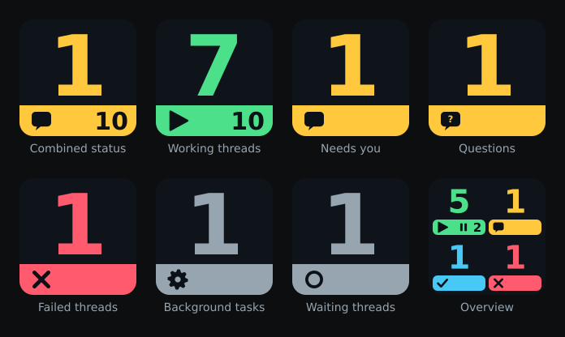

# T3 Code Status for OpenDeck

OpenDeck keys that show what your T3 Code threads are doing: how many are working, which need your approval, answer, or plan review, which finished while you were away, and which failed or hit a usage limit. It covers every machine you pair, and status arrives live.



Each key shows one large number or symbol, so it stays readable on a 2 cm key. Choose from ten key types and five themes, or use the **Overview** key to see four counts at once.

This is an unofficial community plugin. It is not part of T3 Code or OpenDeck.

## Install

You need:

- **OpenDeck** on Linux, macOS 10.15 or newer, or Windows 10 or newer.
- **Node.js 20 or newer** installed system-wide. OpenDeck starts JavaScript plugins with the system `node`. For a Flatpak OpenDeck on Linux, Node.js must be installed outside Flatpak and be on the system `PATH`; this setup has not been tested yet.
- **T3 Code 0.1 or newer**, which uses orchestration protocol 2. Older or newer protocols show **VERSION** on the key instead of wrong counts.

Then:

1. Start T3 Code and leave its server running.
2. Install `com.beastyrabbit.t3-code-status.streamDeckPlugin` from the [latest release](https://github.com/beastyrabbit/opendeck-t3-code-status/releases/latest) through OpenDeck's plugin manager.
3. Drag **Thread status** or **Overview** from the **T3 Code Status** category onto a free key.
4. In T3 Code, open **Settings → Connections**. Enable **Network access** if the pairing controls are hidden, then create a **Read only** pairing link.
5. Paste the complete link into the key's **Pair an environment** field and select **Pair** within five minutes.

To pair several machines at once over SSH and Tailscale, see [Pairing T3 Code machines](docs/user/pairing.md). On Linux, an optional [setup archive](docs/user/linux-setup.md) can install the plugin and place the key for you.

Releases are tested with OpenDeck 2.14 and a physical Stream Deck on Linux. CI builds and tests on macOS and Windows, but those platforms have not been tested with real keys.

## Documentation

- [Keys and themes](docs/user/keys.md): key types, themes, the Overview key, colours, connection states, and which threads count.
- [Pairing T3 Code machines](docs/user/pairing.md): pairing by hand, **Pair all** over SSH, troubleshooting, and renewal.
- [Automatic key placement on Linux](docs/user/linux-setup.md)
- [Security and privacy](docs/user/security.md): what the plugin can read, where credentials live, and how to verify a release download.
- [Development](docs/dev/development.md) and [architecture](docs/dev/architecture.md) for contributors.

## Build from source

```bash
pnpm install
pnpm verify
pnpm package
```

Development needs Node.js 22.13 or newer and pnpm 11. See [Development](docs/dev/development.md) for packaging, local deployment, and releases.

## AI-assisted development

Codex and Claude Code in T3 Code were used extensively while writing the implementation, tests, and documentation. BeastyRabbit defined the behaviour, reviewed the source, and tested the plugin with a real OpenDeck and T3 Code installation. Substantial AI assistance should be disclosed in contributions, and contributors must understand and verify every change they submit.

## License

MIT
