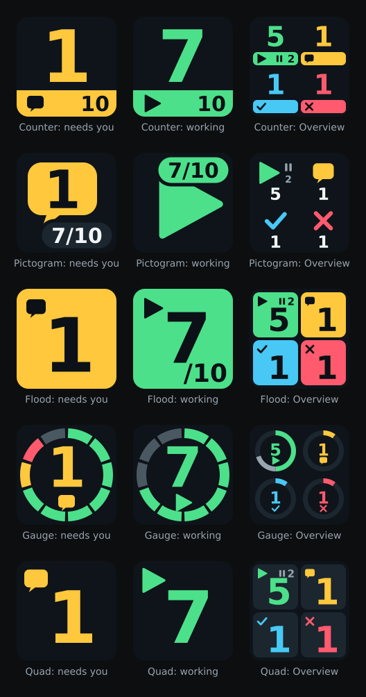
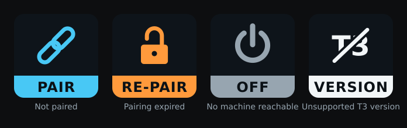

# Keys and themes

The plugin adds two actions to the `T3 Code Status` category in OpenDeck:

- **Thread status** shows one count at a time. Its key type decides what it counts.
- **Overview** shows four counts at once and never blinks.

Every key shows one large number or symbol, so it stays readable on a 2 cm key.

## Key types

Choose what a **Thread status** key shows in its settings. Drag several onto the deck to build a row of separate status keys.

| Key shows | Count | Blinks |
| --- | --- | --- |
| **Combined status** (default) | The most urgent state: requests for you, then failures, usage limits, finished threads you have not opened yet, then working threads, with the open total | While anything needs you |
| **Working threads** | Working threads, with the open total | No |
| **Needs you** | Approvals, questions, and plan reviews together | While any is pending |
| **Approvals** / **Questions** / **Plan reviews** | One request type each | While pending |
| **Failed threads** | Threads whose latest run failed | No |
| **Usage limits** | Threads paused until a provider limit resets | No |
| **Background tasks** | Threads with a background task, such as a dev server | No |
| **Waiting threads** | Open threads that are idle and need nothing from you | No |

On the Counter theme, the small number in the band is the number of open threads, not a second count of working ones.

## Themes

Choose a **Theme** for each key. Every theme supports every key type and the Overview.

- **Counter** (default): a big number with a colour band that holds the status symbol and the open total.
- **Pictogram**: a large status icon with the count in a corner badge.
- **Flood**: the whole key lights up in the status colour; idle keys go dark.
- **Gauge**: a ring with one segment per open thread, coloured by its state.
- **Quad**: a big number in a box, with the status symbol in its corner.

## Overview key

**Thread status** switches to whatever is most urgent. To see several counts at once, drag **Overview** from the same category onto a key. It always shows four counts in fixed places:

| Top left | Top right | Bottom left | Bottom right |
| --- | --- | --- | --- |
| Running threads: the big number counts those actively working, the small ⏸ count those that only wait | Requests for you | Done, not seen: threads that finished after you last opened them | Errors: failures and usage-limit stops |

The two running numbers add up to the running total, the same number the **Working threads** key shows. In the pictures above, 5 working and ⏸ 2 waiting make the 7 of 10 on the other keys. The Gauge theme draws the waiting part as a grey stretch of the ring instead of a number.

A running thread only waits when its run waits on another thread, such as a subagent, or T3 holds it open for a background task. T3's sidebar labels these **Waiting**. "Done, not seen" uses T3's unread rule, so opening the thread in T3 on any device clears it.

The Overview key has only a **Theme** setting.

## Colours and shapes

Colours always come with a shape:

| Colour | Shape | Meaning |
| --- | --- | --- |
| Green | ▶ | Working |
| Yellow | Speech bubble (✓ approval, ? question, ≡ plan) | Requests for you |
| Red | ✕ | Failures |
| Violet | Hourglass | Usage limits |
| Cyan | ✓ | Finished threads you have not opened |
| Grey | ⏸ | Runs that only wait |
| Grey | Gear | Background tasks |
| Grey | Ring | Idle threads |

Blinking keys alternate between their normal look and a full-colour flash about once per second. OpenDeck also exposes the current status as the key's accessible label.

## Connection states

Loading, offline, and connection problems appear on every key type:

| Key | Meaning | What to do |
| --- | --- | --- |
| **PAIR** | No T3 Code server is paired | [Pair a machine](pairing.md) |
| **RE-PAIR** | The saved authorization expired or was revoked | Create a fresh read-only pairing link and paste it into the same settings panel. Re-pairing keeps your keys and replaces the credential. |
| **OFF** | No paired machine can be reached | Check that T3 Code runs and that its network access is on. Press the key to retry. |
| **VERSION** | The T3 Code server speaks an orchestration protocol this plugin does not support | Update the plugin or T3 Code |

While at least one paired machine is connected, the keys count the connected ones and leave the others out; the settings panel names the machines it is not counting. Transient connection failures retry with backoff up to 30 seconds.

Status arrives through a live stream, so questions appear or clear as soon as T3 sends an update. There is no polling interval; the refresh-interval setting of earlier versions is no longer used. Pressing a key does not answer or dismiss a question.

## Which threads count

The plugin counts open top-level threads from every paired machine and applies the same rules as T3 Code's sidebar:

- Archived threads and subagents do not count. A subagent waiting for approval flags its parent thread instead.
- Settled threads do not count unless they are working, waiting for you, or have a guest message waiting.
- Snoozed threads do not count. They reappear when they request approval or input, receive a guest message, or fail after the snooze. A completed run does not wake a snoozed thread.
- Runs that are preparing, queued, starting, running, or finishing count as working, as does background work the agent waits for.
- A command or monitor the agent left running, such as a dev server, counts as waiting.
- A failure caused by a provider usage limit counts as a usage limit, not a failure.

Settlement comes from T3 Code itself: the plugin reads each thread's server-side settled state and does not import per-client sidebar preferences. Counts can differ from a T3 sidebar configured with other local display rules.
